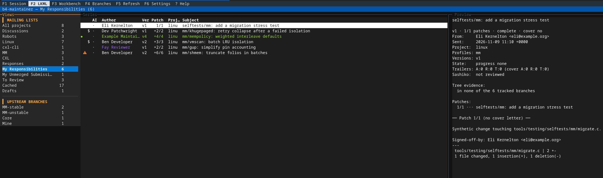
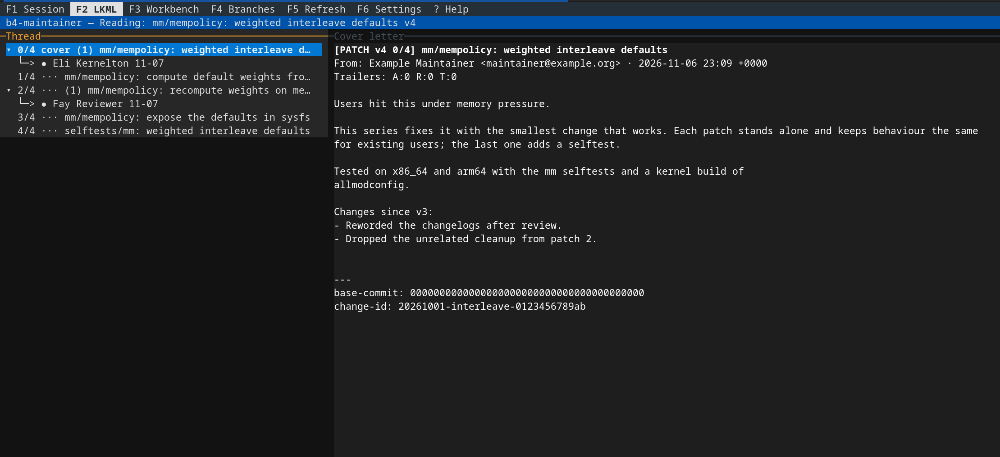
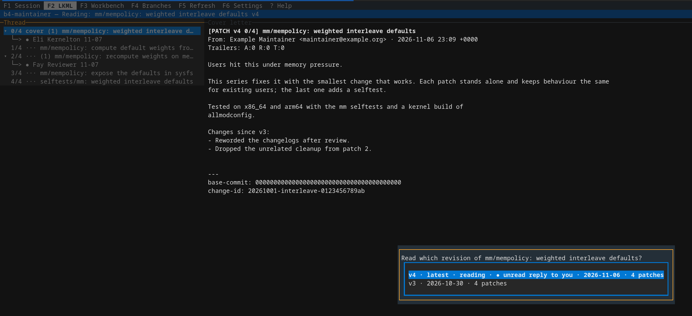
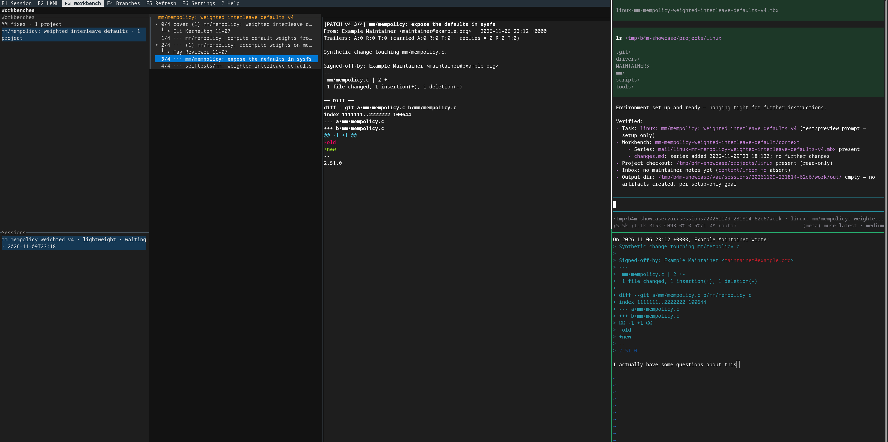
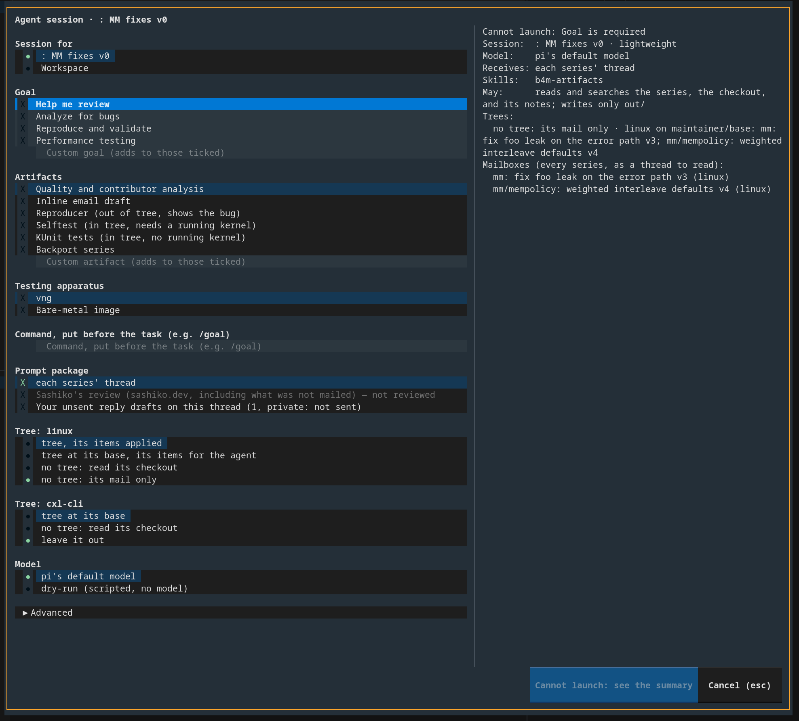
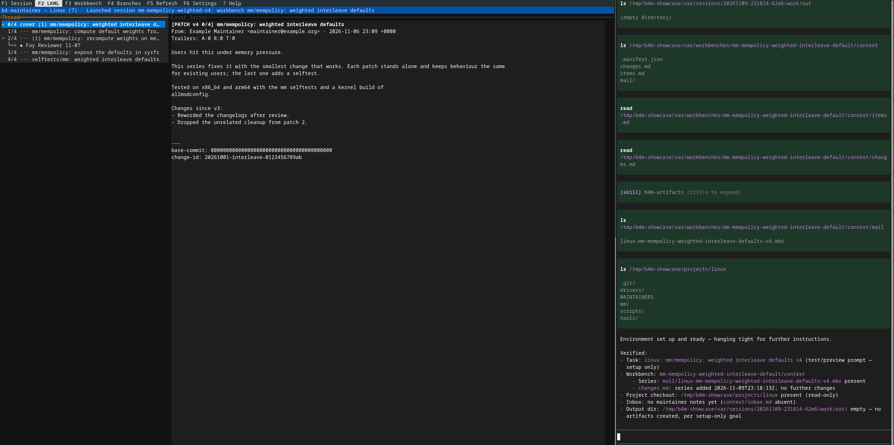
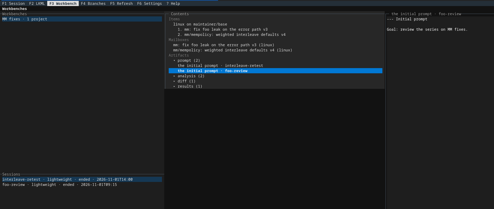

# b4-maintainer

Your mailing-list inbox as a maintainer, in the terminal. Built on
[b4](https://b4.docs.kernel.org/), it shows what needs you, where every series is
upstream, and lets you reply, or hand a series to an AI agent, without leaving it.

## How it works

**1. See what needs you.** The series on the lists you follow, sorted into what is
yours to act on: replies to your mail, files you maintain, series you track, your own
unmerged work. Upstream branches (mm-stable, linux-next, …) get views of their own.



**2. Read the series.** Threads read like a mail client, with the review state at a
glance: trailers, unread replies, and which upstream branches already carry it.



**3. Keep up with the conversation.** Every revision stays readable, and a reply to
your review of v3 is not lost when v4 is out: the series opens where it is.



**4. Reply in your own editor.** The draft opens beside the thread; b4 sends it with
your identity and signing.



**5. Hand it to an agent, when you want one.** A review, a bug hunt, a reproducer, a
retest: pick the goal and what the agent gets. It works beside you, on its own copy
of the trees, reading the same threads. Agents start only when you launch them.





**6. Collect what comes back.** Workbenches gather series, branches, and files for
agents, and keep what they leave: findings, reports, diffs, and test results, ready
for your reply or your next revision.



## Try it

    ./setup.sh
    ./b4-maintainer --showcase /tmp/b4m-showcase

The showcase is a synthetic workspace with everything filled in: made-up people and
lists, so nothing in it is real and nothing is ever sent. Delete the directory to start
again. (`--demo DIR` opens the smaller workspace the tests use.)

Status: early, in daily use. Python 3.11+, [Textual](https://textual.textualize.io/),
GPL-2.0-or-later.

## Contents

- [Setup](#setup)
- [Concepts](#concepts)
- [The tabs](#the-tabs): [LKML](#lkml-f2), [Workbench](#workbench-f3),
  [Branches](#branches-f4), [Settings](#settings-f6), [Sessions](#sessions-f1)
- [Mail](#mail)
- [Configuration](#configuration)
- [Development](#development)

## Setup

    git clone <b4-maintainer repository> b4-maintainer && cd b4-maintainer
    ./setup.sh
    ./b4-maintainer

- `./setup.sh` initialises the submodules, creates `.venv`, installs the pinned
  packages, and runs `b4-maintainer setup`, which clones missing project checkouts
  (blobless; Linux takes a while), enrolls them with workspace-local b4 state, and
  imports any tracked series recorded in `state/`. It is safe to run again.
- The first run writes `setup.conf` (from `setup.conf.example`; ignored by Git):
  - `STATE_REPO`: a repository cloned once as `state/`, holding your configuration
    and workbenches. The app never pushes or pulls it.
  - `PYTHON`: the interpreter (default: the newest `python3.1x`).
  - `DEV_TOOLS=yes`: also install pytest and ruff.
- An optional site file adapts setup to its environment: `setup.site.conf` (ignored),
  or the file `SITE_CONF` names. Both `setup.sh` and `./b4-maintainer` source it. It
  may export environment (proxies), set a default `PYTHON`, add `PIP_ARGS`, or define
  `site_install` to replace pip.
- `./b4-maintainer` runs the workspace's app from any directory. `./b4-maintainer
  linux` opens on one project's view.
- To register a checkout you already have: `b4-maintainer project add ID --list LIST
  --ref LABEL:REF:AUTHORITY` (the checkout at `projects/ID`).

Per machine, and never exported: your Git identity and b4's `sendemail.*` settings,
drafts, caches, and review branches.

## Concepts

| Term | What it is |
|---|---|
| Workspace | This directory: `state/workspace.toml` (or `workspace.toml`), the project checkouts under `projects/`, and runtime data under `var/`. |
| Project | A repository you maintain (Linux, QEMU, ndctl, …): its checkout, its lists, and its tracked branches. |
| Profile | A set of lists you follow for a project (e.g. MM, CXL). Profiles are what `F5` fetches, and each has a sidebar view. |
| Tracked branch | An upstream branch (a *ref*) checked for each series: mainline, linux-next, a subsystem's queues. |
| Maintainer base | Your own integration branch on top of an upstream branch, where you apply and test series. |
| Workbench | A recipe for agent sessions: per project, a base and the series, branches, and files to give the agent. |
| Session | An agent (pi, in tmux) working on a workbench. Its results land in its `out/` folder. |
| Kept artifact | A copy of session output (a reproducer, a report, logs) kept with a commit or on a shelf. It outlives its session and workbench. |

Series are matched to projects by the lists they were sent to. On lists that projects
share, a subject tag (`[ndctl PATCH]`) or the directories a series touches decide.

## The tabs

| Key | Tab |
|---|---|
| `F1` | Start an agent session on what is selected (see [Sessions](#sessions-f1)). |
| `F2` | **LKML**: the series list and threads. |
| `F3` | **Workbench**: workbenches, their contents, and their sessions. |
| `F4` | **Branches**: bases, prep branches, session work, and sending. |
| `F5` | Refresh: fetch mail and branches, from any tab. |
| `F6` | **Settings**: signing and tracked branches. |
| `?` | Every key on the current tab. |

Each tab keeps its place when you switch away. The footer shows the common keys; `` ` ``
opens the session drawer.

### LKML (F2)

The sidebar has two sections.

**Mailing lists**

| View | Lists |
|---|---|
| All | Every series still in review. |
| Discussions | Threads without `[PATCH]`: conversations on your lists. |
| Robots | Reports from syzbot and the kernel test robot. |
| *Project*, *profile* | Series for one project, or on one profile's lists. |
| Responses | Series with unread replies to your mail. |
| My Responsibilities | Series touching files you maintain (from MAINTAINERS). |
| My Unmerged Submissions | Your own series that have not landed, up to a year back. |
| To Review | Series you track in b4. |
| Cached | Everything in the mail cache, landed or not. |
| Drafts, Watching, Hidden | Series with a saved reply draft; discussions you watch; series you hid. |

**Upstream branches** has a view for each tracked branch that has one, listing the
series it holds. A series is listed in the first such view (in configuration order)
and leaves the list views. A series fully in a branch that *ends review* (linux-next,
mainline) leaves the queues.

The pane on the right previews the selected series: its cover letter (or its only
patch), trailers, how many `Fixes:` tags and Cc-stable patches it carries, Sashiko's
review, and *Tree evidence*, the tracked branches holding it. `p` shrinks the preview
to the summary, and back.

| Key | In the series list |
|---|---|
| `Enter` | Read the thread. |
| `p` | Shrink or expand the preview. |
| `/` | Filter by regular expression. |
| `l` | Order by latest activity (a Last column says how long ago), or by posting. |
| `$` | Track the series in b4 (To Review), or untrack it; on a discussion, watch it or stop. `t` also tracks. |
| `x` | Hide the series, or unhide it. |
| `M` | Mark every message in it read. |
| `r`, `R` | Reply to the cover letter; `R` first picks session output to add. |
| `V` | Read an older revision. |
| `w` | Add the series to a workbench. |
| `a`, `d` | Apply the series to a base or prep branch; drop it from a base. |
| `v` | Show or hide the sidebar on a medium-width terminal. |

**Reading a thread.** The tree of messages is on the left and the selected message on
the right. `[` and `]` move between messages, `n` jumps to the next comment, `!` to the
next Sashiko finding, `-` and `=` fold replies, and `z` folds long quotes. `r` replies
to the selected message. Escape goes back. A patch's number (`3/12`) is green when a
tracked upstream branch already holds it (your own local branches do not count).

**Revisions.** Each series is listed at its newest revision. `V` picks an older one to
read, and the status line says when you are not on the newest. When the unread
replies to you are on an older revision (an answer to your review of v1 after v2 is
out), the series opens there; the top of the thread pane names each revision holding
unread replies (`Thread · v2 · [v1 ●]`).

**Applying.** `a` applies a series to a maintainer base or a b4 prep branch of any
project, as `b4 am` would: authors kept, trailers collected, a Link added, no sign-off.
The branch must not be checked out, and it moves only if every patch applies. When
patches conflict, you can hand them to an agent: an apply session resolves them on a
copy, and `A` in Branches accepts its result. `d` drops a series from a base again.

### Workbench (F3)

A workbench gathers what an agent session should see. Per project, it has a base and
items applied on it in order: series (at a revision, or only some patches), local
branches or commits, discussions (read, never applied), and files.

The tab shows the workbenches and the selected one's sessions on the left; its
contents in the middle (Items, Mailboxes, Trees, Artifacts); and the selected row on
the right (for Items, a preview of what a launch prepares).

| Key | |
|---|---|
| `n`, `r`, `x` | New, rename, or remove a workbench (or remove a project from it). |
| `a` | Add a thread (by lore link or Message-ID), a file, a project, or session artifacts. |
| `B`, `b` | Add a local branch; set a project's base. |
| `m`, `shift+↑/↓` | Move an item to another project; reorder items. |
| `v` | Take a series' newer revision. |
| `u` | Apply items added since the space's trees were prepared. |
| `F1` | Launch a session on the workbench. |
| `o`, `Enter` | Open the live session; open a session (or a mailbox's thread) beside the app. |
| `space`, `p`, `P` | On Trees: mark commits; pluck them onto a base, prep branch, or another session's tree; cut a prep branch from them. |
| `f` | On a folded series (fixups squashed in): make the next revision's prep branch. |
| `w` | Add commits, a branch, or a file artifact to a workbench. |
| `k` | Keep an artifact with a commit on a base, or on a shelf (see below). |
| `/` | Search the contents. Groups open and close with `Enter`, `→`, and `←`. |

`w` in the series list, a thread, or Branches adds to a workbench from there. Each
workbench has a space, `var/workbenches/<id>/`, that its sessions work in: a live
`context/` (the items, each thread's mail, files, and what changed), a repository per
project sharing the project's objects, and one checkout per session tree. Mail or files
added while a session runs reach it, with a note in its inbox.

**Keeping artifacts.** Removing a workbench deletes its sessions and their output. To
keep a result for later (say, the reproducer for a pull-ahead fix you have applied), keep
it first. After you pluck a session's commits onto a base or prep branch, you are offered
the session's other artifacts, all ticked, to keep with the new commit. `k` keeps any
artifact, anytime, with a commit on a maintainer base or on a named shelf. A file inside
a folder (`out/reproducers/<name>/README.md`) keeps its whole folder.

Kept copies live in `var/kept/`, on this machine only. They are listed under **Kept
artifacts** at the bottom of the workbench list, grouped by commit and shelf. A commit
in Branches shows what was kept with it, even after a rebase (matched by patch-id, else
subject). When you come back to re-validate, `w` puts a kept artifact on a workbench for
a session to read, and `x` removes it.

### Branches (F4)

Each project, in folding sections: Bases, Rebase and apply sessions, Prep, Session work
(the branches agents left: pull-aheads, fixups, folded series, tests), Review, Other,
and Checkouts. The middle pane lists the selected branch's commits; the right pane the
selected commit; Details says the rest, and `*` marks a branch that needs attention.

| Key | |
|---|---|
| `←`, `→` | Fold, unfold. |
| `b` | Make a plain branch at a base, upstream branch, prep branch, or any ref. |
| `r`, `a`, `A` | Rebase a base; on a conflict, rebase with an agent; accept its result. |
| `space`, `p` | Mark commits; pluck them onto a base, prep branch, or branch. An agent's commits become yours with an `Assisted-by:` trailer. |
| `n` | Make a b4 prep branch from the marked commits, with a drafted cover letter. |
| `w` | Add the branch or commits to a workbench. |
| `k` | On a session's artifact: keep it with a commit or on a shelf (see [Keeping artifacts](#workbench-f3)). |
| `m` | Mail one commit as a patch (a fixup as a reply to the patch it fixes). |
| `x` | Remove a branch, session work, or a session tree, after saying what goes. |

On a prep branch:

| Key | |
|---|---|
| `t` | Add recipients (`b4 prep --auto-to-cc`). |
| `c` | Run the checks. |
| `e`, `E` | Edit the cover letter; edit the selected commit's message. |
| `s` | Add your Signed-off-by (you certify the DCO). |
| `u` | Collect trailers from the list. |
| `d` | Compare with the last revision sent. |
| `o` | Preview exactly what would be sent (`b4 send -o`). |
| `S` | Send. A summary comes first, and sending is refused while there are no recipients, the cover letter still says EDITME, a commit lacks your sign-off, or checks fail. Then b4 runs in the terminal and asks once more. |

### Settings (F6)

**Signing.** Which key signs your mail, and setting one up in your global git
configuration: an existing PGP key from gpg, a new patatt ed25519 key, or no signing.
Without a key, mail goes out unsigned.

**Upstream branches.** Each project's tracked branches, with what membership in each
means:

- **Authority**: `mainline` (where series land; one per project), `acceptance` (a
  maintainer took the series, e.g. mm-stable or a for-next), or `preliminary` (queued
  for testing, e.g. mm-unstable).
- **View**: a sidebar view listing what the branch holds.
- **Ends review**: a series fully in the branch leaves every queue.

`Enter` on *Track a branch* picks a remote (or a new one by URL), a branch listed from
it, then the settings above; the branch is fetched into the checkout and added to the
configuration. `Enter` on a branch changes it; `d` untracks it, and its remote goes
once nothing else uses it. Settings rewrites only that project's `refs = [...]` lines,
and a branch that one of your bases builds on cannot be untracked.

### Sessions (F1)

`F1` launches an agent session (pi, in a tmux window beside the app). Every session
runs in a workbench: on the Workbench tab it uses that one; on a series it makes one
from the series, or offers the workbenches that already hold it.

The launch dialog picks the goal and, for each project, how the agent gets it: a tree
with the items applied, a tree at the base with the items to apply itself, the checkout
to read, or the mail only. The prompt package holds each series' thread, Sashiko's
reviews, and, only if you tick them, your unsent drafts on that thread.

Sessions write their results under `out/` and list them in `out/artifacts.toml`:
findings, reports, reproducers, results, and proposed changes. They appear under the
workbench's Artifacts, and `R` can add them to a reply.

| Key | In the drawer (`` ` ``) |
|---|---|
| `Enter` | Show the session beside the app. |
| `s`, `x` | Stop it; end it. |
| `o` | List its artifacts. |
| `n` | Rename it. |

Sessions have names (`mm-fix-foo-leak-v3`, a workbench's label), mapped from their
timestamp ids in `var/sessions/names.toml`.

## Mail

**Refresh.** `F5` fetches, from lore:

- each profile's lists for the last `[browse] window_days` (14): series (`[PATCH]` and
  `[RFC]`), then the threads without `[PATCH]`, which are listed as discussions or
  robot reports;
- mail from or to you, as whole threads;
- the series you posted in the last `[browse] own_days` (365), kept that long for My
  Unmerged Submissions;
- the threads you watch, whole. Threads a workbench names stay cached as long as it
  does.

It then fetches the remotes of your tracked branches and checks which series they
hold. Threads whose first subject matches a `[browse] exclude` pattern are skipped;
the default skips stable `-rc` review postings, which copy every backport's author.

**Replies.** `r` drafts a reply in your editor (the one b4 runs: `core.editor`,
`$EDITOR`): in a tmux pane beside the app when it runs in tmux, otherwise in the app's
own terminal, the app suspended until you quit. When the editor exits, b4's preview
of the reply opens, and it is sent from there with your identity and signing
(`--email-dry-run` to test). Drafts stay in `var/drafts/` until sent or discarded.

**Unread.** Responses uses b4's Seen flag. Replies that arrive with old threads of
yours, already older than the browse window, count as read.

## Configuration

`state/workspace.toml` (or `workspace.toml` at the top) is the workspace's
configuration. `var/workspace.toml` overrides it on one machine and is never exported
unless asked: tables merge key by key, and `[[projects]]`, `[[profiles]]`, and
`[[models]]` entries merge by `id`. Unknown keys are reported in the status line.

```toml
me = ["you@example.org"]

[[projects]]
id = "linux"
path = "projects/linux"
lists = ["linux-mm@kvack.org", "linux-cxl@vger.kernel.org"]
refs = [
  { label = "m", name = "mainline/master", authority = "mainline" },
  { label = "n", name = "next/master", authority = "acceptance", ends_review = true },
  { label = "s", name = "mm/mm-stable", authority = "acceptance", view = "MM-stable" },
]
bases = [{ branch = "you/base", upstream = "mm/mm-stable" }]

[[profiles]]
id = "mm"
label = "MM"
project = "linux"
lists = ["linux-mm@kvack.org"]
```

| Key | Meaning |
|---|---|
| `me` | Your addresses: your own series and the replies to you. |
| `[[projects]]` `id`, `label`, `path`, `lists` | A project, its checkout, and the lists its series are sent to. |
| `refs` | Tracked branches: `label` (one character), `name`, `authority`, and optional `view` and `ends_review` (default: mainline only). Settings edits these. |
| `bases` | Maintainer bases: `branch` on top of `upstream`. |
| `subject_tags` | Subject tags that claim a series for this project on shared lists (`["ndctl", "daxctl"]`). |
| `maintainers`, `get_maintainer` | The MAINTAINERS file and the command that answers ownership (default: `scripts/get_maintainer.pl`). |
| `base_refs`, `track_branches` | Private, in `var/workspace.toml`: read-only bases (`["origin/v*-x"]`), and remote branches kept as local branches (`["origin/scratch/<you>/*"]`). |
| `[[profiles]]` `id`, `label`, `project`, `lists`, `paths`, `enabled` | Lists you follow. A profile labelled like its project stands in for the project's view. |
| `[browse]` `window_days`, `own_days`, `exclude` | How far back list mail (14) and your own series (365) are kept; subject patterns to skip. |
| `[refs]` `fetch` | Fetch tracked branches' remotes on `F5` (default true). |
| `[drafts]` `editor`, `tmux_width` | `auto` (tmux pane, else this terminal), `terminal`, or `app` (the in-app pane). |
| `[sashiko]` `senders`, `hide_clean` | Sashiko's addresses; leave its replies that found nothing out of threads. |
| `[layout]` `three_pane`, `single_pane`, `preview_width` | Terminal widths for the layouts (160, 100) and the expanded preview (100). |
| `[sessions]` | Session limits (`max_live`, `max_builds`), `pi` and `pi_args`, `pane_width`, the agent's commit identity, sandbox priority, `assisted_by`. |
| `[[models]]` | Model presets for the launch dialog. |
| `[[guidance]]` `id`, `path` | Use another checkout of a guidance source (e.g. review-prompts). |

**Moving between machines.** `b4-maintainer state export FILE` writes a tar.gz of the
configuration, workbenches, tracked series, flags, and how each checkout was cloned,
leaving private data out unless `--private`. `b4-maintainer state import FILE` adds
what is missing on the other machine; then `b4-maintainer setup` clones any missing
checkout.

**Bases from the command line.** `b4-maintainer bases` shows how far behind each base
is and which of its commits have landed; `--rebase BRANCH` replays the rest onto the
upstream branch (never in a checkout; a conflict changes nothing).

## Development

    ./setup.sh                                 # with DEV_TOOLS=yes in setup.conf
    .venv/bin/python -m pytest -n auto         # in parallel; timing tests skipped
    .venv/bin/python -m pytest -m serial       # the timing tests, alone
    ./b4-maintainer --showcase /tmp/b4m-showcase

- [Contributor instructions](AGENTS.md).
- Pinned dependencies, as submodules under `deps/`: b4, liblore, review-prompts,
  kernel-style, virtme-ng, kres, semcode, sashiko. See [deps/README.md](deps/README.md).
  Changes belong in the owning dependency where they can; the app's adapters stay
  focused on integration.
- Mail is parsed offline through the pinned b4. Keep real mail for testing under the
  ignored `.local/`.
- A hang: `kill -USR1 <pid>` writes every thread's stack to
  `/tmp/b4-maintainer-<pid>.stacks` without stopping the app.
